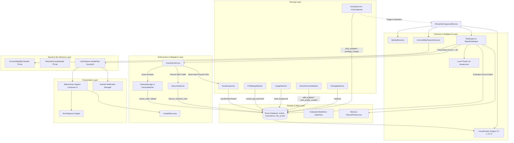
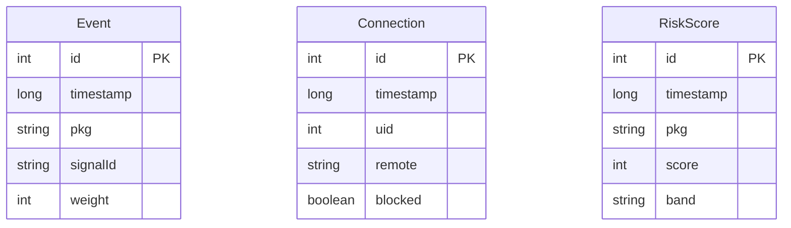

# DHRASHTA-X — Comprehensive Project Architecture & Context

> **Namespace**: `com.dhrashta.x`  
> **Target SDK**: Android 14 (API 34) | **Min SDK**: Android 8.0 (API 26)  
> **Core Language**: Kotlin 1.9.24 / JVM 17 | **UI Toolkit**: Jetpack Compose (BOM 2024.09.00)  
> **Persistence**: Android Room 2.6.1 SQLite  
> **On-Device AI**: TensorFlow Lite 2.16.1 (NNAPI Delegate) + Google MediaPipe Tasks GenAI 0.10.14  

---

## 1. Executive Summary & Problem Statement

**DHRASHTA-X** is an autonomous, on-device Endpoint Detection and Response (EDR) and threat containment system for Android. It is engineered specifically to combat advanced Android banking trojans (e.g., Anubis, Cerberus, TeaBot, SharkBot, Hook) that exploit Android's Accessibility Services, sideloading mechanisms, device management profiles, and covert network channels to execute unauthorized financial transactions, credential harvesting, and screen-eavesdropping.

### Core Objectives
1. **Zero Cloud Telemetry Dependency**: All sensing, neural inference, causal reasoning, and mitigation occur strictly on-device. No user telemetry, app lists, or network packets leave the device.
2. **Dual-Layer Intelligence**: Combines deterministic heuristic rule evaluations and temporal order-aware causal chains with on-device machine learning (TFLite neural networks and local SmolLM2 LLM generation).
3. **Surgical Containment without Device Disruption**: Employs a local Android VPN service operating in a dual-mode configuration: passive DNS monitoring during normal operation, and granular per-UID network black-holing upon critical threat detection, preserving network access for all other legitimate applications.
4. **Accessible, Multilingual Human-in-the-Loop AI**: Explains technical security events to non-technical users in plain English, Hindi, or Bengali using on-device quantized LLMs accompanied by local text-to-speech (TTS).

---

## 2. High-Level System Architecture



---

## 3. Component Deep Dive

### 3.1. Sensing Engine (`com.dhrashta.x.sensing`)

The sensing subsystem runs continuously inside `DhrashtaForegroundService` (`android:foregroundServiceType="specialUse"`), orchestrating multiple specialized watchers:

| Watcher | Mechanism | Signals & Events Detected |
|---|---|---|
| `A11yObserver` | `ContentObserver` on `Settings.Secure.ENABLED_ACCESSIBILITY_SERVICES` | Emits `a11y_enabled` and `privilege_change`. Triggers asynchronous evaluation of newly enabled third-party accessibility packages. |
| `A11yInspector` | `AccessibilityManager.getEnabledAccessibilityServiceList` | Inspects flags: `isAccessibilityTool` (Android 12+), `canRetrieveWindowContent`, `canPerformGestures`, `canRequestFilterKeyEvents`, and `listensToAllPackages`. |
| `PackageWatcher` | BroadcastReceiver on `ACTION_PACKAGE_ADDED` | Identifies package installations. Determines whether the package was sideloaded (`installer != com.android.vending`) and emits `sideload`. |
| `DevicePostureWatcher` | `ContentObserver` on `ADB_ENABLED` and `adb_wifi_enabled`; BroadcastReceiver on `ACTION_MANAGED_PROFILE_ADDED` | Detects developer/wireless debugging activations (`adb_enabled`) and creation of work/enterprise profiles (`work_profile_created`). |
| `UsageWatcher` | Polling `UsageStatsManager.queryEvents` every 15 seconds (requires `PACKAGE_USAGE_STATS`) | Detects when protected banking/UPI applications enter the foreground, logging `bank_foreground` under the device-wide pseudo-package `_device`. |
| `ProfileAppWatcher` | `LauncherApps.Callback` | Detects when an application is cloned or installed inside a secondary user or work profile, emitting `cloned_app_launched`. |
| `IdentityResolver` | Android `PackageManager` | Computes APK signing certificate SHA-256 fingerprints, resolves installer package identity, verifies presence of a launcher activity, and checks sensitive permissions (`SYSTEM_ALERT_WINDOW`, `QUERY_ALL_PACKAGES`). |
| `PostureChecker` | Reads current global settings and user profile counts | Checks instantaneous state of ADB debugging and profile proliferation. |
| `BootReceiver` | BroadcastReceiver on `BOOT_COMPLETED` | Automatically restarts `DhrashtaForegroundService` upon system reboot. |

---

### 3.2. Decision & Causal Inference Engine (`com.dhrashta.x.decision`)

#### Risk Scoring Formula
The final risk score is computed as:
$$\text{Score} = \max\left(0, \sum_{s \in \text{FiredSignals}} \text{Weight}(s) + \text{CausalBonus}\right)$$

Where $\text{CausalBonus} \in [0, 30]$ is the sum of bonuses from all completed temporal causal chains.

#### Risk Bands
- **`SAFE`** ($0 \le \text{Score} < 30$): Normal operations.
- **`REVIEW`** ($30 \le \text{Score} < 60$): Suspicious characteristics; user review suggested.
- **`HIGH`** ($60 \le \text{Score} < 90$): High risk detected; prompt alert shown.
- **`CRITICAL`** ($\text{Score} \ge 90$): Malicious behavior confirmed; automatic network containment triggered if VPN permission is granted.

#### Signal Catalogue (`SignalCatalogue.kt`)
| Signal ID | Weight | Description | Category |
|---|---|---|---|
| `A1` | +15 | Enabled service is not a registered `isAccessibilityTool` | Accessibility |
| `A2` | +10 | Capability: Can retrieve window content | Accessibility |
| `A3` | +10 | Capability: Can perform gestures | Accessibility |
| `A4` | +10 | Capability: Can filter key events (keylogger potential) | Accessibility |
| `A5` | +5 | Listens to all packages (global event scope) | Accessibility |
| `A6` | +15 | Service enabled within 10 minutes of initial install | Provocative Timing |
| `B1` | +15 | Sideloaded (installed outside Google Play Store) | Provenance |
| `B4` | +50 | Signing certificate SHA-256 matches threat feed | Known Threat |
| `B5` | +15 | App has no launcher activity / icon (stealth app) | Concealment |
| `B6` | +20 | App label or package mimics bank/government brand | Phishing / Spoofing |
| `C1` | +10 | Requests `SYSTEM_ALERT_WINDOW` (overlay permission) | UI Hijacking |
| `C5` | +5 | Requests `QUERY_ALL_PACKAGES` (app enumeration) | Reconnaissance |
| `D1` | +10 | Wireless debugging / ADB enabled recently | Posture Vulnerability |
| `D2` | +20 | New work/managed profile appeared | Isolation Bypass |
| `E4` | +20 | Network anomaly classifier score > 0.70 | Neural ML |
| `E5` | +20 | Accessibility MLP classifier confidence > 0.80 | Neural ML |
| `HIGH_TAINT_MATCH` | +50 | Planted canary token observed leaving the device | Exfiltration Proof |
| `N1` | -30 | Registered `isAccessibilityTool` + Google Play install | Neutralizing |
| `N2` | -100 | Package present in user allow-list | Neutralizing |
| `N3` | -40 | Pre-installed system application (`FLAG_SYSTEM`) | Neutralizing |

#### Brand Impersonation Protection
`RiskEngine.nameMimicsProtectedBrand()` applies Levenshtein string distance ($\le 1$) against canonical Indian banking and government identifiers:
- Banking: `sbi`, `hdfc`, `icici`, `axisbank`, `paytm`
- National Identity & Tax: `uidai`, `aadhaar`, `incometax`

#### Causal Chains (`CausalChains.kt`)
Trojans frequently assemble benign-looking capabilities across time. The Causal Chains engine tracks sequential events across a rolling 60-minute lookback window:

```mermaid
sequenceDiagram
    autonumber
    Note over CausalChains: Order-Aware Temporal Correlation
    
    rect rgb(40, 20, 20)
    Note over CausalChains: CC-1 (Window: 10 min | Bonus: +15)
    App->>System: Sideload install (PackageWatcher)
    App->>System: Enable Accessibility Service (A11yObserver)
    end

    rect rgb(40, 30, 20)
    Note over CausalChains: CC-2 (Window: 5 min | Bonus: +15)
    App->>System: Accessibility Enabled (A11yObserver)
    App->>Network: DNS Beaconing to Unknown Host (BeaconDetector)
    end

    rect rgb(50, 10, 10)
    Note over CausalChains: CC-3 (Window: 60 s | Bonus: +25)
    User->>System: Sensitive Bank / UPI app in foreground (UsageWatcher)
    App->>System: Decoy Canary Token read (CanaryMatcher)
    App->>Network: Unencrypted Upload / Exfiltration (GuardVpnService)
    end

    rect rgb(30, 20, 40)
    Note over CausalChains: CC-4 (Window: 10 min | Bonus: +15)
    User->>System: ADB / Wireless Debugging turned ON (DevicePostureWatcher)
    App->>System: Privilege / Accessibility Grant (A11yObserver)
    end

    rect rgb(20, 30, 40)
    Note over CausalChains: CC-5 (Window: 30 min | Bonus: +20)
    System->>System: Managed Work Profile Created (DevicePostureWatcher)
    App->>System: Cloned App Added to Work Profile (ProfileAppWatcher)
    end
```



---

### 3.3. On-Device AI & Machine Learning Pipeline (`com.dhrashta.x.ai`)

All AI/ML capabilities run locally on-device. If model assets are absent from `app/src/main/assets`, the application fails closed to the deterministic heuristic rules engine without crashes or hallucinations.

```
app/src/main/assets/
├── accessibility_mlp.tflite    # 12-feature MLP classifier
├── network_anomaly.tflite      # 9-feature network anomaly model
├── smollm2_360m.gguf           # MediaPipe GenAI LLM
└── threats.json                # Threat feed (hashes, packages, domains)
```

#### 1. Accessibility MLP Classifier (`AccessibilityMlpClassifier.kt`)
- **Input**: 12 normalized features extracted by `AccessibilityFeatureExtractor`:
  1. `isAccessibilityTool`
  2. `canRetrieveWindowContent`
  3. `canPerformGestures`
  4. `canRequestFilterKeyEvents`
  5. `listensToAllPackages`
  6. Sideloaded flag
  7. Time since install ($\le 10\text{ min}$)
  8. `SYSTEM_ALERT_WINDOW` requested
  9. `QUERY_ALL_PACKAGES` requested
  10. ADB active
  11. New profile created
  12. Cert in threat list
- **Inference**: TensorFlow Lite with NNAPI hardware delegate fallback to 4 CPU threads.
- **Output**: 3-class softmax probability: `BlockAccess`, `ManipulateUI`, `ContentEavesdrop`.

#### 2. Network Anomaly Model (`NetworkAnomalyModel.kt`)
- **Input**: 9 traffic flow metrics:
  1. Connection count
  2. Unique destination IPs
  3. Bytes uploaded
  4. Bytes downloaded
  5. Upload/download byte ratio
  6. Packet interval variance (jitter)
  7. Percentage of raw IP connections (bypassing DNS)
  8. Time elapsed since banking app was in foreground
  9. Screen on/off status
- **Output**: Anomaly score $[0.0, 1.0]$. Fired as signal `E4` if $> 0.70$.

#### 3. Multilingual LLM Explainer (`LlmExplainer.kt`)
- **Model**: `smollm2_360m.gguf` running via Google MediaPipe Tasks GenAI (`com.google.mediapipe:tasks-genai:0.10.14`).
- **Configuration**: Max tokens 64, temperature 0.3.
- **Languages Supported**: English, Hindi (`hi`), Bengali (`bn`).
- **Guardrails**: Prompt strictly instructs the model not to invent claims or say "confirmed malware", but state observable telemetry and recommended action in $< 60$ words.
- **Graceful Fallbacks**: Pre-computed localized fallback messages for English, Hindi, and Bengali if inference runtime or model file is unavailable.

---

### 3.4. Containment & Enforcement Engine (`com.dhrashta.x.enforcement`)

#### 1. Dual-Mode Local VPN Service (`GuardVpnService.kt`)
`GuardVpnService` extends Android's `VpnService` to provide network interception and containment without routing external traffic through remote proxy servers:

1. **Passive DNS Monitor Mode (Default)**:
   - Established when no applications are paused (`pausedUids.isEmpty()`).
   - Routes only the virtual IP `10.0.0.3/32` as DNS server using `DnsForwarder`.
   - Explicitly disallows the app's own package (`addDisallowedApplication(packageName)`).
   - Forwards real DNS requests to the underlying network resolver (or `1.1.1.1`), feeding captured queries to `BeaconDetector` and inspecting payloads for canary tokens.
2. **Active Per-App Containment Mode (Critical Action)**:
   - Activated when one or more UIDs are paused (`ACTION_PAUSE_UID`).
   - Uses `addAllowedApplication(pkg)` for **only** the quarantined packages.
   - Configures `0.0.0.0/0` and `::/0` routes on the TUN interface.
   - The VPN background coroutine drains packets from the TUN file descriptor **without writing replies**, black-holing all outbound IPv4 and IPv6 connections from the target app.
   - All other applications on the device remain completely unhindered on the standard Wi-Fi / Cellular network.

#### 2. Beacon Detection (`BeaconDetector.kt`)
Identifies periodic Command-and-Control (C2) heartbeats from DNS lookups:
- Tracks rolling 10-minute history per UID in circular scratch buffers.
- Requires $\ge 5$ queries for the same domain.
- Computes the Coefficient of Variation:
  $$CV = \frac{\sigma}{\mu} = \frac{\sqrt{\frac{1}{N-1}\sum (t_i - t_{i-1} - \mu)^2}}{\mu}$$
- If $CV < 0.15$, the interval is strictly periodic (beaconing).
- Filters out recognized major CDNs and services (`BeaconDetector.KNOWN_GOOD`: Google, WhatsApp, Facebook, AWS, Cloudflare, Akamai).
- Emits `beacon_unknown_host` and requests immediate app re-evaluation.

#### 3. Canary Token Decoy System (`CanaryManager.kt` & `CanaryMatcher.kt`)
Plants synthetic canary tokens prefixed with `DHRX-` that no benign app has reason to touch:
- **Contact Canary**: Decoy contact ("DHRASHTA Canary", `+91 90000 00000`, `DHRX-CT-xxxxxxxx@canary.invalid`) inserted into `ContactsContract`.
- **UUID Canary**: Random decoy device UUID in `SharedPreferences`.
- **Credential Canary**: Fixed account number `DHRX-ACC-7712-9910-4408`.
- **Device Marker**: Derived from truncated `ANDROID_ID` (`DHRX-DEV-xxxxxxxx`).
- `CanaryMatcher.scan()` uses Boyer-Moore byte matching on network packets leaving through the VPN or DNS tunnels. A match immediately emits `canary_read` and `upload` events, triggering CC-3 evaluation and instant high-risk attribution.

#### 4. Guided Recovery (`GuidedRecovery.kt`)
Safely launches Android platform intent dialogues to empower users to remediate threats:
- `openA11ySettings()`: Opens `Settings.ACTION_ACCESSIBILITY_SETTINGS` to disable rogue services.
- `openAppInfo()`: Opens `Settings.ACTION_APPLICATION_DETAILS_SETTINGS` to revoke overlay or SMS permissions.
- `requestUninstall()`: Dispatches `Intent.ACTION_DELETE` package URI for clean uninstallation.

---

### 3.5. Data Layer & Schemas (`com.dhrashta.x.data`)

Persistence is managed by Room SQLite (`RoomDb.kt`):

#### Database Entities (`Entities.kt`)


- **`Event` (`events` table)**: Records both rule signal triggers (`A1`, `B1`) with weights and behavioural events (`sideload`, `a11y_enabled`, `canary_read`, `bank_foreground`, `beacon_unknown_host`) with weight `0`.
- **`Connection` (`connections` table)**: Logs connection attempts, remote IP endpoints, and whether the flow was black-holed.
- **`RiskScore` (`risk_scores` table)**: Audit history of evaluated risk scores and bands per package over time.

#### State Management
- `EvaluationStateStore`: Thread-safe singleton with a Kotlin `StateFlow<EvaluationState>` delivering live monitoring status, currently evaluating package, scores, fired signals, and containment flags to Compose screens.
- `AllowList`: User-managed package whitelist persisted in `SharedPreferences` (`allow_list`), applying an immediate `-100` score offset to neutralize false positives.

---

### 3.6. User Interface Architecture (`com.dhrashta.x.ui`)

Built with Jetpack Compose using an editorial forest-green color palette (`DhrashtaTheme.kt`):

```
ui/
├── MainActivity.kt            # Navigation state machine & permission lifecycle
├── DashboardScreen.kt         # Shield status banner, risk cards, quick activity
├── RiskDetailsScreen.kt       # Full forensic breakdown, causal chains, LLM diagnosis, TTS
├── InternetPausedScreen.kt    # Dedicated quarantined app view with live blocked count
├── ActivityScreen.kt          # Chronological timeline of all security events
├── SettingsScreen.kt          # Sensor diagnostics, permission checks, language selector
├── AppInventory.kt            # App aggregation, quick heuristic scoring, icon caching
└── components/
    └── AppComponents.kt       # Cards, buttons, tags, status pills, metrics
```

#### Key UI Flows
1. **Home / Dashboard**: Shows overall shield state (Active / Threat Detected), summary metrics (Apps checked, Paused apps, Active sensors), categorized list of installed applications with risk badges, and recent forensic events.
2. **Risk Details**: Displays calculated score, risk level badge, plain-language explanation, text-to-speech voice readout button ("Listen"), list of fired rules and causal chains, and direct mitigation controls (Pause Internet, Review Permissions, Uninstall, Trust).
3. **Internet Paused Console**: Visual feedback when an app's network access is paused, displaying live count of blocked outbound connections and timestamp of the last blocked packet.
4. **Settings & Diagnostics**: Verifies health of all local sensors:
   - Accessibility Monitor Service
   - VPN Consent & DNS Monitor
   - Usage Access Permission
   - Notifications Permission
   - Contacts Access (Canary deployment)
   - On-Device AI Model Asset Readiness (MLP, Network Anomaly, SmolLM2)

---

## 4. Android Security Model & Permissions

DHRASHTA-X requests only permissions necessary for on-device defense:

```xml
<!-- Foreground Monitoring -->
<uses-permission android:name="android.permission.FOREGROUND_SERVICE" />
<uses-permission android:name="android.permission.FOREGROUND_SERVICE_SPECIAL_USE" />
<uses-permission android:name="android.permission.POST_NOTIFICATIONS" />
<uses-permission android:name="android.permission.RECEIVE_BOOT_COMPLETED" />

<!-- App & Capability Discovery -->
<uses-permission android:name="android.permission.QUERY_ALL_PACKAGES" />
<uses-permission android:name="android.permission.PACKAGE_USAGE_STATS" tools:ignore="ProtectedPermissions" />

<!-- Containment & Decoy Detection -->
<uses-permission android:name="android.permission.INTERNET" />
<uses-permission android:name="android.permission.WRITE_CONTACTS" />
```

### Permission Elevation Strategy
- **`PACKAGE_USAGE_STATS`**: Directs user to `Settings.ACTION_USAGE_ACCESS_SETTINGS`. If not granted, `UsageWatcher` gracefully idles and CC-3 remains inactive without affecting other detectors.
- **`BIND_VPN_SERVICE`**: Uses standard `VpnService.prepare()` flow before starting `GuardVpnService`. If denied, user is prompted that network containment and DNS beacon detection cannot operate.
- **`WRITE_CONTACTS`**: Requested at runtime to plant the decoy contact. If denied, contact canary is skipped while UUID, credential, and device marker canaries remain active.

---

## 5. Development & Build Environment

### Tooling Specification
- **Android Gradle Plugin (AGP)**: Compatible with Android Studio Ladybug / Koala
- **Kotlin**: 1.9.24 (`org.jetbrains.kotlin.android`, `kapt`)
- **Java**: OpenJDK 17 (`sourceCompatibility` & `targetCompatibility = 17`)
- **ProGuard / R8**: Enabled in release mode (`proguard-rules.pro`)

### Key Build Files
- `build.gradle.kts`: Top-level build configuration.
- `app/build.gradle.kts`: Application module dependencies (Compose BOM, Room, WorkManager, Dexlib2, TFLite, MediaPipe).
- `scripts/android-env.sh`: Environment setup script defining local SDK/JDK tooling paths:
  ```bash
  source scripts/android-env.sh
  ```

### Running Tests
- **JVM Unit Tests**: `RiskEngineTest.kt` covers threshold boundary conditions and allow-list neutralization.
  ```bash
  ./gradlew test
  ```
- **Android Lint / Build**:
  ```bash
  ./gradlew assembleDebug
  ```

---

## 6. Git History & Branches

The repository (`srinivasr/iqoo`) maintains a clean, linear commit history on `main`:

```
d330e76 Add sensors, DNS beacon detection, canary system and real-data UI
620d56a Phase 1: Implement Causal Chains
9201c85 chore: ignore generated Room schemas
637d61e fix: polish UI build and verify Android app
0c79c86 feat: add paused state and complete navigation
9262d6f feat: add risk details and pause action
ab5872b feat: build dashboard interface
2b981c4 chore: set up Android project and design system
```

The feature branches `origin/phase-1-causal-chains` and `origin/phase-a-bank-foreground` represent the sequential evolution of the causal reasoning engine and the foreground sensing/VPN containment systems, respectively, and are fully merged into `main`.
