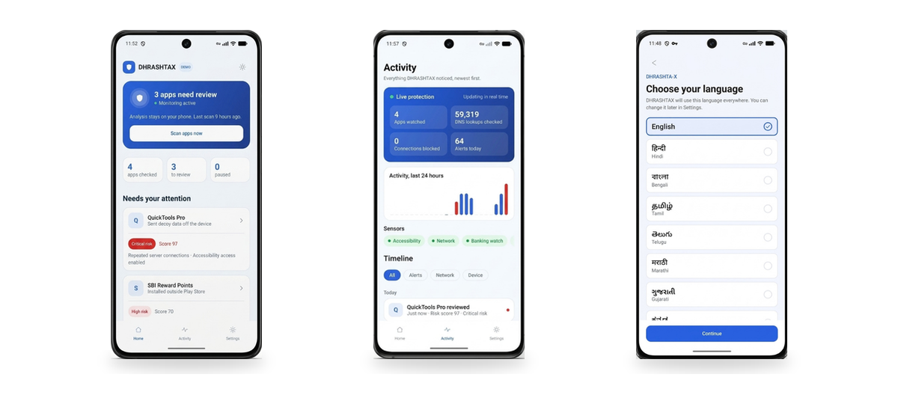
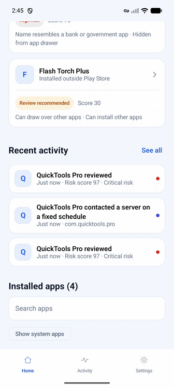

<div align="center">

# DHRASHTA-X

On-device detection of accessibility-abuse and banking-trojan patterns on Android, with per-app network containment. No telemetry. Android 8.0+ (API 26), targets API 36.

[](https://kotlinlang.org)
[](https://developer.android.com)
[](https://developer.android.com/compose)
[-0D9488.svg?style=flat)](https://github.com/srinivasr/iqoo)

<p align="center">
  <a href="#overview">Overview</a> •
  <a href="#visual-tour">Visual Tour</a> •
  <a href="#what-it-does-and-does-not-see">Coverage</a> •
  <a href="#architecture">Architecture</a> •
  <a href="#temporal-causal-chains">Causal Chains</a> •
  <a href="#network-containment">Quarantine</a> •
  <a href="#quick-start">Quick Start</a>
</p>

</div>

## Overview

Android banking trojans usually work in steps: a sideloaded app asks for Accessibility, waits for a bank app to open, then acts. DHRASHTA-X looks for those steps **in order**, on the phone, and can cut the network for one suspicious app while every other app keeps working.

- Scoring, explanations and containment all run locally. DHRASHTA-X sends no telemetry.
- Order-aware causal chains (for example: sideload, then Accessibility within 10 minutes) add to the score only when at least one step belongs to the app being scored.
- Per-app containment: a VPN scoped to the paused app only. The app is shown as paused only after that tunnel exists.
- Optional decoy data (off by default) catches an app that tries to send a planted value through DNS or while it is paused. The packet is dropped, so it is recorded as a blocked attempt.
- Explanations are built only from the signals that actually fired, in English, Hindi and Bengali (other languages fall back to English for the newest text), with Text-to-Speech.

DHRASHTA-X raises evidence-based risk scores. A high score is a reason to review an app, not proof that it is malware.

## Visual Tour

<p align="center">
  
</p>

<p align="center">
  <em>Left to right: (1) Home dashboard with threat scores and pending reviews; (2) Activity timeline with sensor telemetry and hourly breakdown; (3) First-launch language selection.</em>
</p>

<h3 align="center">Threat Evaluation & Network Containment</h3>

<p align="center">
  <a href="docs/assets/demo-video.mp4">
    
  </a>
</p>

<p align="center">
  <em>Screen capture of threat scoring and per-app isolation. Click the preview to watch the full recording (<a href="docs/assets/demo-video.mp4">demo-video.mp4</a>).</em>
</p>

## What it does and does not see

Settings → **What is monitored** shows this list live on the phone.

| Area | Status in this build |
|---|---|
| Accessibility services | Watched continuously (enable events + every scan) |
| DNS lookups | Watched when the DNS monitor is on (needs VPN consent); used for beacon timing |
| Full network traffic | **Not captured.** Only DNS lookups and already-paused apps pass through the VPN |
| Banking app in foreground | Needs Usage Access |
| Decoy data | Opt-in. Plain-text DNS/paused-app traffic only; TLS payloads are never matched |
| Network threat model | Loaded and verified on-device with a golden self-test (see below). Live traffic is **not** fed to it, because full-flow capture does not exist yet; it never invents a score |
| Accessibility model | Not bundled. The loader only accepts a model with a `BENIGN` class |
| Threat list | Release ships an empty list with provenance (`meta.source`). Debug builds load labelled demo values |

## On-device models

Bundled from `dhrashta-x-v3`: a 13-class network MLP (82 features per 5-second window), quantized (QDQ, 25 KB) with a float fallback. `app/src/main/assets/models/network_model.json` holds the feature order, class order, scaler and file hashes.

- **Backend is reported, not assumed.** The app first tries Android NNAPI with NNAPI's CPU path and ONNX Runtime's CPU fallback both disabled; a session only exists in that mode if every node runs on an accelerator. Otherwise it runs on the ONNX Runtime CPU provider and says so.
- **Self-test:** Settings → *Run model self-test* replays the 13 golden windows from `test-data/test_vector.json` and compares with outputs recorded from ONNX Runtime on the same files (tolerance 0.05).
- Known result on those 13 vectors: 12/13 top-class correct. The `C2_BEACON` window is classified `BENIGN` by the MLPs (and by the XGBoost baseline).

## Temporal causal chains

| Chain | Sequence | Window | Bonus |
|---|---|---|---|
| `CC-1` | Sideload → Accessibility enabled | 10 min | +15 |
| `CC-2` | Accessibility enabled → DNS beacon from this app | 5 min | +15 |
| `CC-3` | Banking app in foreground → this app tries to send a decoy (blocked) | 60 s | +25 |
| `CC-4` | ADB enabled → privilege grant to this app | 10 min | +15 |
| `CC-5` | Work profile created → this app appears in a profile | 30 min | +20 |

The total chain bonus is capped at +30. Device-wide events (ADB, bank foreground, work profile) can complete a chain only together with a step logged under the app itself.

## Scoring, bands and trust

`Score = max(0, sum of fired signal weights + chain bonus)`

| Band | Score | Default action |
|---|---|---|
| `SAFE` | 0–29 | None |
| `REVIEW` | 30–59 | Notify |
| `HIGH` | 60–89 | Notify with guided review |
| `CRITICAL` | ≥ 90 | Request per-app containment (shown as paused only once confirmed) |

**Trusted apps** keep their real score everywhere (engine, list, details). Trust only mutes automatic containment and alerts, except for hard evidence (certificate on the threat list, or a blocked decoy attempt), which still alerts. One policy (`TrustPolicy`) is used by the engine, the notifications and the UI.

Brand impersonation (`B6`) ignores official bank/government packages, Play-installed apps and system apps; short names such as "sbi" must be a whole word, so "Usb input" does not match.

## Network containment

`GuardVpnService` has two modes:

- **DNS monitor** (nothing paused): routes only the virtual resolver `10.0.0.53`. Each query gets its own relay ID (no cross-client mix-ups), IPv4 headers are validated, large answers are sent as IP fragments, TCP to the resolver gets an immediate RST, and IPv6 traffic is explicitly allowed to bypass. A query carrying a decoy is not forwarded.
- **Containment** (one or more apps paused): a tunnel scoped with `addAllowedApplication` to those apps only. If no package can be added, no tunnel is created (an empty allow-list would capture every app).

## Build

Requirements: Android Studio (recent, with Android SDK Platform 36) or JDK 17 + Android SDK. The Gradle wrapper (Gradle 8.11.1, Android Gradle Plugin 8.10.1) is included.

```bash
./gradlew test            # JVM unit tests
./gradlew assembleDebug   # app/build/outputs/apk/debug/app-debug.apk
```

On Windows use `gradlew.bat`. `scripts/android-env.sh` is optional: it uses a project-local `.tooling/` folder only if one exists.

## Project structure

```
iqoo/
├── app/src/main/
│   ├── assets/models/        # ONNX models, metadata, self-test vectors
│   ├── assets/threats.json   # Empty indicator list with provenance (release)
│   └── java/com/dhrashta/x/
│       ├── ai/               # ONNX Runtime wrapper, network classifier, optional a11y model
│       ├── data/             # Room database (pruned to 7 days / row caps), allow list, state
│       ├── decision/         # RiskEngine, CausalChains, TrustPolicy, BrandHeuristic, explanations
│       ├── enforcement/      # GuardVpnService, DnsForwarder, decoys, beacon detector
│       ├── sensing/          # Accessibility, package, posture, usage, profile watchers
│       └── ui/               # Compose screens
├── app/src/debug/assets/     # Labelled demo threat list (debug builds only)
├── dhrashta-x-v3/            # Model source package (training scripts, schema, test vectors)
└── docs/assets/              # Screenshots and demo video
```

## License

Copyright © 2026 the DHRASHTA-X authors. All rights reserved; see [LICENSE](LICENSE).
